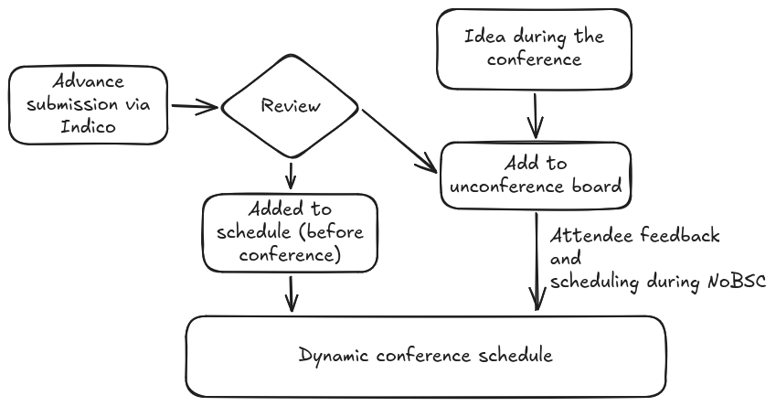

Call for contributions
=======================

The theme of this conference is how we actually work and "the problems
we found along the way", not "advertising our product".  You can
present ideas, what you couldn't do, open problems, things you need
advice on, and so on.

We will accept advance submissions of all the normal types (talk,
lightning talk, workshop) in addition to the :doc:`unconference track
<unconference>`, where sessions are proposed and scheduled during the
meeting.  We will schedule some sessions in advance, and some promoted
to the unconference track :inote:`Meaning: the unconference board will
be seeded with these ideas.`

   You can submit in advance or not, and we will schedule some things
   in advance and some during the meeting.

We have four different rooms available to us (of different sizes and
arrangements), plus lots of lobby area for informal breakout.

Contribution inspirations
---------------------------

**You are allowed (and encouraged) to come with a question instead of
a solution.  You are also encouraged to present failures.** You can
present short talks (lightning/talk) or longer workshops.  We will try
to find a place for everything, though lengths may be adjusted.

Tech:

* I have written this nice tool...
* I need this nice tool...
* Problem or concern I am facing now.
* Cool procedure/practice/tool we have developed.
* Cool software I have developed.
* Demo or poster about something you would like to have input on.

Community:

* Introduction to how my team/organization works.
* How my team solves some problem.
* My thinking about some problem.
* Book/video/event review and summary.
