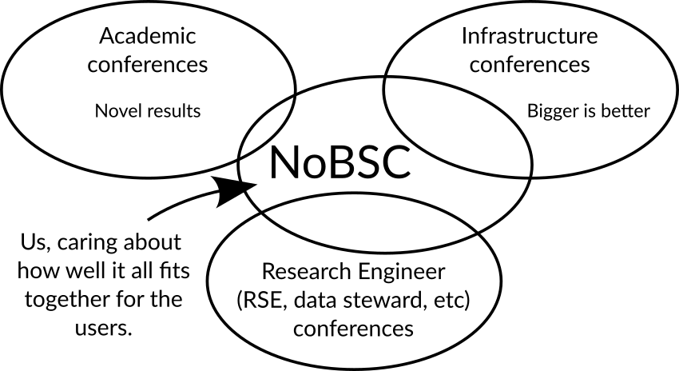

Nordic Basic Scientific Computing 2027
======================================

.. toctree::
   :hidden:
   :caption: Information

   what-is-NoBSC
   about
   sponsorship
   faq

.. toctree::
   :hidden:
   :caption: Attend

   registration
   practical-info

.. toctree::
   :hidden:
   :caption: Program

   schedule
   unconference
   call-for-sessions

Nordic Basic Scientific Computing is a gathering of those interested
in supporting scientific computing (and a celebration of the diverse
work that makes it all possible).

We gather for practical discussion and experience-sharing in the world
of teams supporting {computing, data, and software}.  It's a
time to roll up our sleeves, look under the hood and talk about what
we really do each day (and not just advertise how good we are).

You can find plenty of conferences where people talk about how big
their computers are, or how they should support researcher with
technology, or how nice their citations are.  But there's some
intersection, a "full-stack" view from the research support to the
infrastructure.  With "AI" putting computing and data tools into
everyone's hands, this is more important than ever.

Basic info:

* Aalto University campus, Helsinki :inote:`actually Otaniemi, Espoo,
  but I bet either you come from far enough away it doesn't matter, or
  near enough you already know`
* 2027 February 10-12 (Wed-Fri), roughly "lunch to lunch".
* CSC Ambassador's meet-up on the Tuesday before.
* If you would like space for other satellite meetings on the morning
  before / afternoon after, let the organizers know.  Our spaces are reserved.
* For more info, see `the 2026 edition
  <https://aaltoscicomp.github.io/NoBSC/>`__
