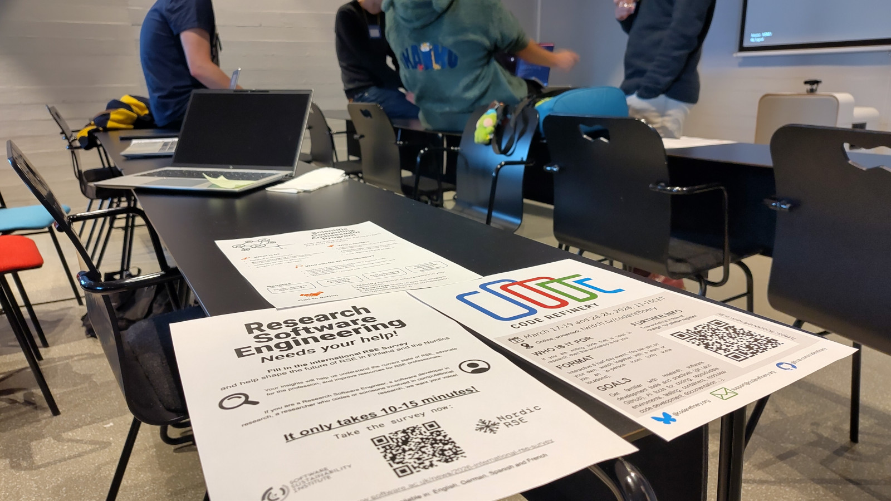
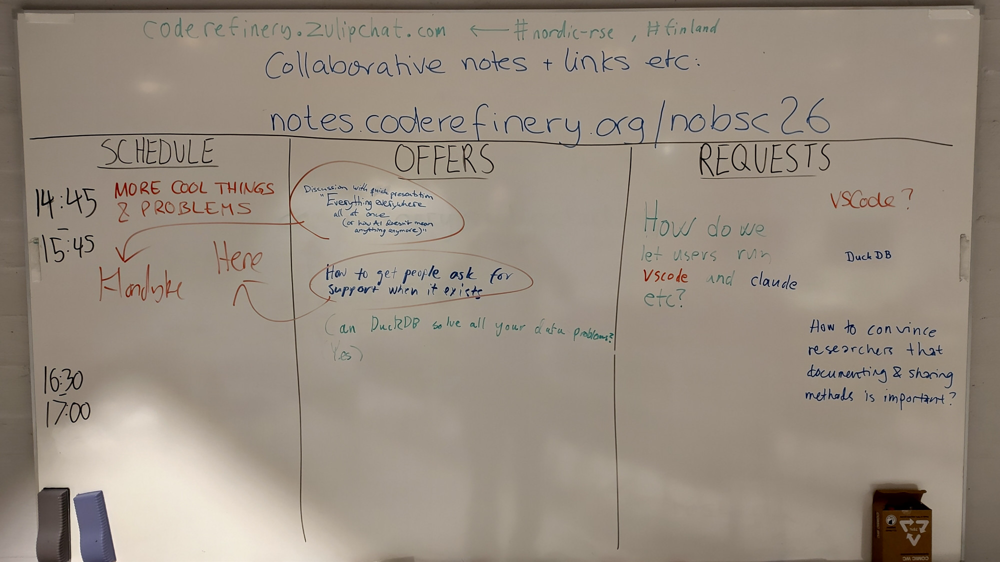
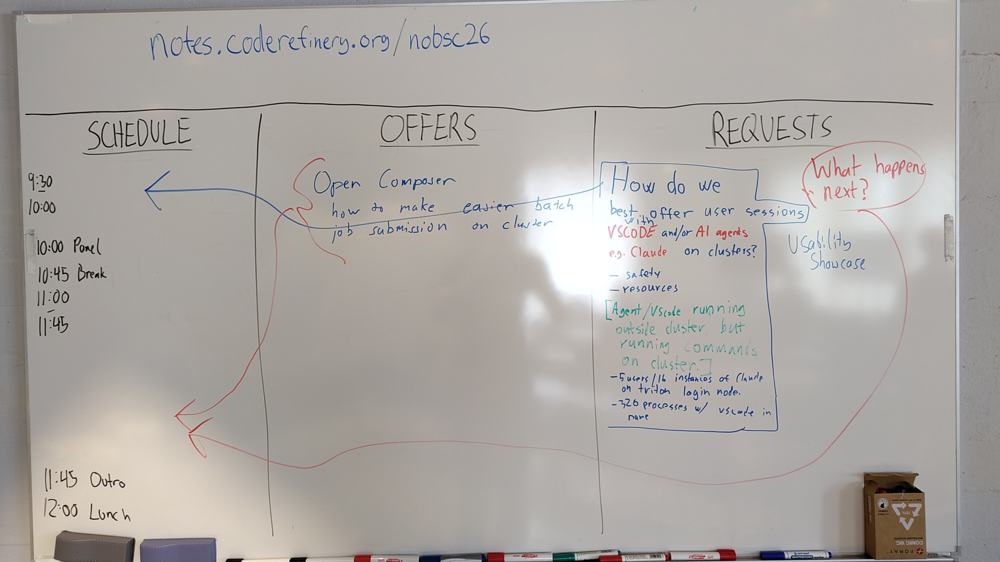
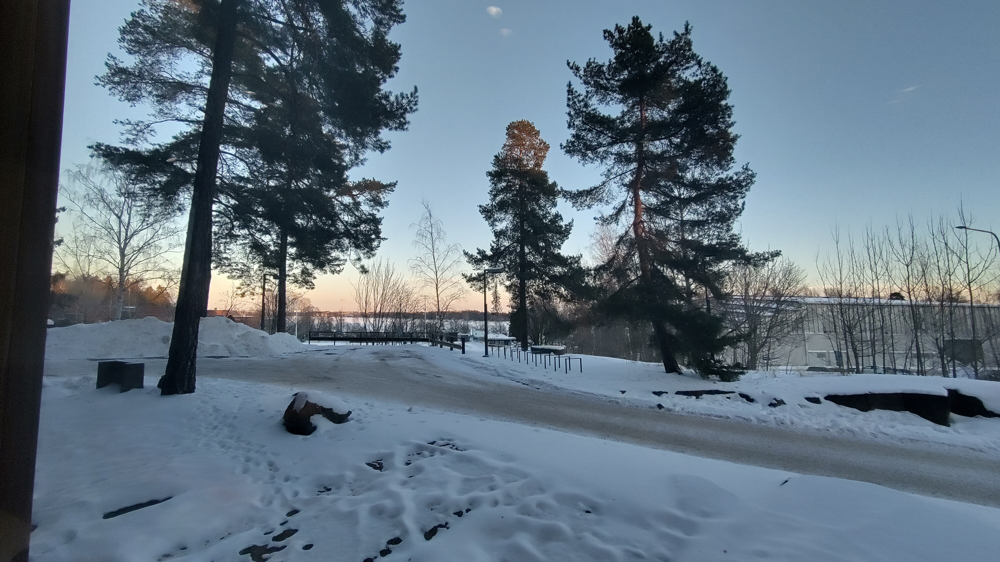
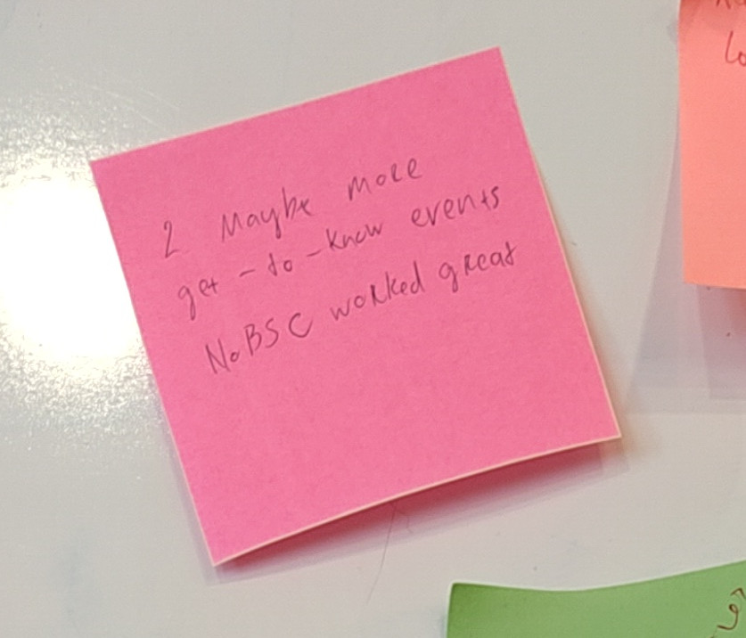

What is NoBSC?
==============

Don't we wish we had an easy answer...

Long story short, we, the organizers, worked together from the
bottom-up as part of CodeRefinery (teaching), Nordic-RSE (research
engineering), and our own infrastructure teams.  This combined view
let us do so much more than we could otherwise, weaving together user
support, making better infrastructure for users, and having fun
learning new things.  We wanted to continue it, so here we are.

Plus, we wanted more local meetups.  A local community is good, and we
have shown that Nordics-Baltics are a nice, cohesive unit.

Our goal is to emphasize the "hallway track" by allowing talks to be
scheduled ad-hoc, and not just advertising known solutions but talking
about what we *don't* have a solution for yet.

Pictures
--------

   Lots of time for talking.

   Creating the program as we go.

   More creating the program as it happened.  We were learning along
   the way, but it worked well.

   Weather was cold but nice.

   Attendees wanted more.
